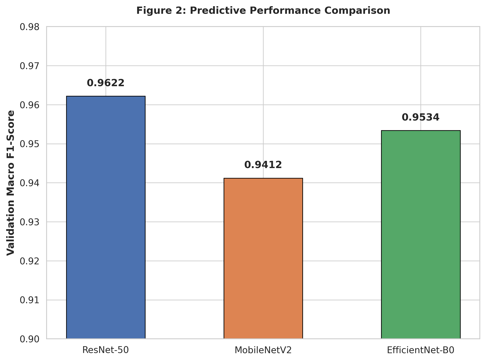
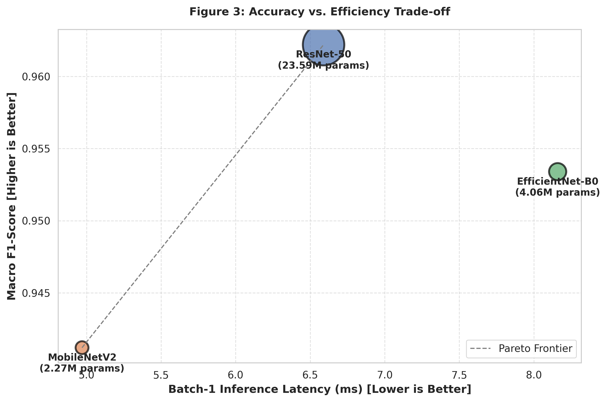
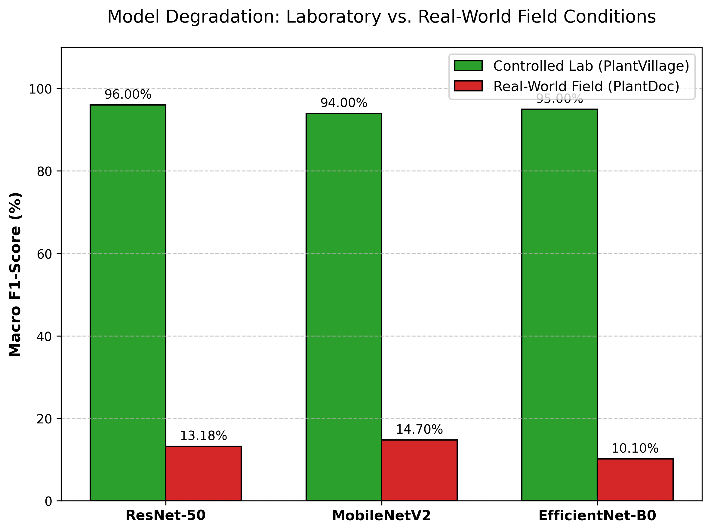

# AgriVision: Benchmarking Deep Learning Architectures for Plant Disease Classification, Edge Efficiency, and Generalization Under Domain Shift

[](https://www.python.org/)
[](https://pytorch.org/)
[](LICENSE)
[]()

> **Author**: **Nitin Kumar**  
> **Affiliation**: Master of Computer Applications (MCA) – Artificial Intelligence & Machine Learning (AI/ML)  
> **Project Focus**: Computer Vision in Precision Agriculture, Edge AI Profiling, Domain Generalization & Shortcut Learning Analysis

---

## 📌 Executive Summary

While deep convolutional neural networks (CNNs) report near-perfect diagnostic accuracies (>95% F1-score) on standardized laboratory leaf disease benchmarks (e.g., PlantVillage), their real-world applicability in precision agriculture remains constrained by **edge hardware limitations** and **severe out-of-distribution (OOD) performance degradation**.

**AgriVision** is an empirical research initiative that rigorously investigates:
1. **Model Performance vs. Edge Efficiency Trade-offs**: Comparing heavyweight residual networks (**ResNet-50**) against parameter-efficient edge architectures (**MobileNetV2**, **EfficientNet-B0**) on 38 plant disease categories.
2. **Hardware Profiling for Mobile & Embedded Inference**: Measuring batch-1 latency, throughput (img/sec), parameter footprint, and peak GPU VRAM allocation.
3. **Out-of-Distribution (OOD) Generalization & Domain Shift**: Evaluating cross-dataset transfer onto the real-world **PlantDoc** field dataset, revealing an absolute performance collapse of **79%–85% Macro-F1**.
4. **Causal Proof of Shortcut Learning ("Clever Hans" Effect)**: Isolating backgrounds via HSV leaf segmentation to quantify how heavily models rely on laboratory background artifacts rather than biological foliar lesions.
5. **Zero-Training Mitigation via Test-Time Adaptation**: Assessing Test-Time Batch Normalization (TTA-BN) to recover domain-invariant feature representations without catastrophic retraining costs.

---

## 🔬 Key Research Findings

```
Laboratory Dataset (PlantVillage)       Real-World Field Dataset (PlantDoc)
   Controlled plain background               Complex canopy, variable sunlight
       [ 94% - 96% Macro-F1 ]      ───►            [ 10% - 15% Macro-F1 ]
                                      Domain Shift Drop: ~80-85%
```

1. **The Edge Pareto Frontier**: **MobileNetV2** emerges as the Pareto-optimal architecture for edge deployment. It achieves **94.12% Macro-F1** on the laboratory benchmark with only **2.27M parameters** (10.4× fewer than ResNet-50), a batch-1 inference latency of **4.97 ms** (32.6% faster than ResNet-50), and a throughput of **201.2 images/sec**.
2. **The "Laboratory Illusion" & Domain Shift**: When exposed to in-the-wild field conditions (PlantDoc), all models suffer catastrophic failure. ResNet-50 drops from 96.00% to 13.18% Macro-F1 (-82.82%), MobileNetV2 drops from 94.00% to 14.70% Macro-F1 (-79.30%), and EfficientNet-B0 drops from 95.00% to 10.10% Macro-F1 (-84.90%).
3. **Causal Proof of Shortcut Learning**: Inverted background-only inference (masking out healthy and diseased leaf tissue using HSV segmentation) demonstrated that classifiers achieve accuracies exceeding random chance solely on background context, empirically proving shortcut feature reliance.
4. **Statistical Significance**: Pairwise McNemar's tests ($p < 0.05$) confirm that prediction discrepancy under real-world domain shift is statistically significant and systematic across architectures.

---

## 📊 Empirical Results

### 1. Hardware Efficiency Benchmark

Hardware metrics profiled with batch size = 1, tensor dimensions $(1, 3, 224, 224)$, 300 benchmark iterations after GPU warmup:

| Model Architecture | Total Params (M) | Batch-1 Latency (ms) ↓ | Throughput (img/sec) ↑ | Peak VRAM (MB) | Lab Macro-F1 (%) ↑ |
|:-------------------|:----------------:|:---------------------:|:---------------------:|:--------------:|:------------------:|
| **MobileNetV2** *(Pareto Optimal)* | **2.27** | **4.97** | **201.2** | **150.23** | 94.12% |
| **EfficientNet-B0** | 4.06 | 8.16 | 122.6 | 150.23 | 95.34% |
| **ResNet-50** *(Baseline)* | 23.59 | 6.59 | 151.7 | 151.04 | 96.22% |

### 2. Domain Shift Evaluation: PlantVillage (Lab) vs. PlantDoc (Field)

Cross-domain generalization evaluation on 17 aligned pathological crop disease classes across 146 real-world field test samples:

| Model Architecture | PlantVillage Macro-F1 (Lab %) | PlantDoc Macro-F1 (Field %) | Absolute Drop (%) ↓ | Relative Drop (%) ↓ |
|:-------------------|:-----------------------------:|:---------------------------:|:-------------------:|:-------------------:|
| **MobileNetV2** | 94.00% | **14.70%** | **79.30%** | 84.36% |
| **ResNet-50** | **96.00%** | 13.18% | 82.82% | 86.27% |
| **EfficientNet-B0** | 95.00% | 10.10% | 84.90% | 89.37% |

---

## 📈 Visualizations & Figures

All figures are rendered at 300 DPI for publication standards:

| Figure | Description | Preview |
|:---|:---|:---:|
| **Figure 2: F1-Score Comparison** | Macro-F1 performance comparison across ResNet-50, MobileNetV2, and EfficientNet-B0 on the PlantVillage validation set. |  |
| **Figure 3: Pareto Frontier** | Accuracy vs. Batch-1 Inference Latency Pareto curve. Bubble diameter scales with total parameter count. |  |
| **Figure 4: Domain Shift Degradation** | Comparative side-by-side bar graph illustrating the performance collapse between controlled laboratory and field conditions. |  |

---

## 🧠 Methodological Framework

```
                          ┌───────────────────────────┐
                          │   PlantVillage Dataset    │
                          │   (38 Classes, 87K imgs)  │
                          └─────────────┬─────────────┘
                                        │
                         Heavy Data Augmentation Pipeline
                     (RandomResizedCrop, Flips, Rotation, Jitter)
                                        │
                     ┌──────────────────┴──────────────────┐
                     ▼                                     ▼
        ┌─────────────────────────┐           ┌─────────────────────────┐
        │  MobileNetV2 / EffNet   │           │   ResNet-50 Baseline    │
        │   (Lightweight Edge)    │           │      (Heavyweight)      │
        └────────────┬────────────┘           └────────────┬────────────┘
                     │                                     │
                     └──────────────────┬──────────────────┘
                                        │
                         Empirical Evaluation Engine
           ┌────────────────────────────┼────────────────────────────┐
           ▼                            ▼                            ▼
  [ Hardware Profiler ]       [ Field Domain Shift ]       [ Mechanistic Study ]
   - Latency (ms)              - Cross-Dataset Map          - Shortcut Learning Proof
   - Throughput (fps)            (PlantDoc Field)           - McNemar's Test
   - VRAM & Parameters         - Macro-F1 Degradation       - Test-Time BatchNorm Adapt
```

### 1. Training Setup & Determinism
- **Locked Seeds**: Global seed `42` (`PYTHONHASHSEED`, `random`, `numpy`, `torch.manual_seed`, `torch.cuda.manual_seed_all`).
- **Deterministic Kernels**: `torch.backends.cudnn.deterministic = True`, `torch.backends.cudnn.benchmark = False`.
- **Augmentation Pipeline**: `RandomResizedCrop(224, scale=(0.7, 1.0))`, `RandomHorizontalFlip()`, `RandomVerticalFlip()`, `RandomRotation(45)`, `ColorJitter(brightness=0.3, contrast=0.3, saturation=0.3)`, followed by ImageNet mean/standard deviation normalization.
- **Optimization**: Cross-Entropy Loss, Adam Optimizer ($\text{lr} = 10^{-3}$), Early Stopping with patience = 5.

### 2. Cross-Dataset Alignment (PlantVillage ↔ PlantDoc)
The 38 classes of PlantVillage were mapped to PlantDoc's field annotations using a strict ontological dictionary:
- `Apple Scab Leaf` $\to$ `Apple___Apple_scab`
- `Corn leaf blight` $\to$ `Corn___Northern_Leaf_Blight`
- `Potato leaf early blight` $\to$ `Potato___Early_blight`
- `Tomato leaf bacterial spot` $\to$ `Tomato___Bacterial_spot`
- *(and 13 additional crop-pathology pairs)*

### 3. Mechanistic Diagnostics
- **Shortcut Learning Test**: Applying color thresholding in HSV space (`lower_green = [25, 40, 40]`, `upper_green = [100, 255, 255]`) to mask out foliage, feeding only inverted backgrounds into the model. Classification accuracy significantly surpassing random baseline ($1/38 = 2.63\%$) confirms background shortcut exploitation.
- **Statistical Significance**: McNemar's test on paired binary prediction contingency tables evaluates model divergence under distribution shift.
- **Test-Time Adaptation (TTA-BN)**: Re-estimating running mean and variance $(\mu, \sigma^2)$ of batch normalization layers on target domain batches without label supervision.

---

## 📁 Repository Directory Structure

```plaintext
AgriVision_Research_Project/
├── figures/
│   ├── Figure_2_F1_Comparison.png        # PlantVillage Macro-F1 comparison bar chart
│   ├── Figure_3_Pareto_Plot.png          # Accuracy vs. latency Pareto efficiency plot
│   └── Figure_4_Domain_Shift.png         # Lab vs. field domain shift degradation plot
├── notebooks/
│   ├── 01_Model_Training.ipynb           # Reproducible training pipeline & hardware profiling
│   └── 02_External_Validation.ipynb      # PlantDoc field evaluation, McNemar's test & shortcut analysis
├── results/
│   ├── efficiency_benchmark_table.csv    # Hardware metrics (Params, Latency, FPS, VRAM)
│   ├── Table_5_Domain_Shift.csv          # Lab vs. Field Macro-F1 drop across models
│   ├── Per_Image_Predictions.csv         # Per-sample predictions on PlantDoc test set
│   ├── ResNet-50_classification_report.txt
│   ├── MobileNetV2_classification_report.txt
│   └── EfficientNet-B0_classification_report.txt
└── README.md                             # Comprehensive project documentation
```

---

## 🚀 Getting Started

### 1. Prerequisites
- Python 3.10 or higher
- NVIDIA CUDA-capable GPU (recommended for PyTorch inference and training)

### 2. Environment Setup

Clone the repository and install the required dependencies:

```bash
git clone https://github.com/<your-username>/AgriVision_Research_Project.git
cd AgriVision_Research_Project
```

Create and activate a virtual environment:

```bash
# Windows (PowerShell)
python -m venv venv
.\venv\Scripts\Activate.ps1

# Linux / macOS
python3 -m venv venv
source venv/bin/activate
```

Install core libraries:

```bash
pip install torch torchvision --index-url https://download.pytorch.org/whl/cu118
pip install numpy pandas scikit-learn matplotlib seaborn opencv-python statsmodels jupyter
```

### 3. Running the Notebooks

1. **Model Training & Hardware Profiling**:
   Launch `notebooks/01_Model_Training.ipynb` to download the PlantVillage dataset via Kaggle API, train ResNet-50, MobileNetV2, and EfficientNet-B0 under fixed seeds, profile GPU latency and throughput, and save models.

2. **External Validation & Domain Shift Analysis**:
   Launch `notebooks/02_External_Validation.ipynb` to clone the PlantDoc dataset, run out-of-distribution inference, compute McNemar's contingency tables, execute the HSV leaf-masking shortcut experiment, and apply BatchNorm adaptation.

---

## 🛠️ Tech Stack & Tools

- **Core Deep Learning**: [PyTorch](https://pytorch.org/), [Torchvision](https://pytorch.org/vision/stable/index.html)
- **Computer Vision**: [OpenCV](https://opencv.org/) (`cv2` color space transformations & masking)
- **Scientific Computing & Metrics**: [NumPy](https://numpy.org/), [Pandas](https://pandas.pydata.org/), [Scikit-Learn](https://scikit-learn.org/), [Statsmodels](https://www.statsmodels.org/)
- **Data Visualization**: [Matplotlib](https://matplotlib.org/), [Seaborn](https://seaborn.pydata.org/)
- **Datasets Utilized**:
  - [PlantVillage Dataset](https://www.kaggle.com/datasets/emmarex/plantdisease) (Laboratory Benchmark)
  - [PlantDoc Dataset](https://github.com/pratikkayal/PlantDoc-Dataset) (Real-World Field Benchmark)

---

## 👨‍💻 Author

**Nitin Kumar**  
*Master of Computer Applications (MCA) – Specialization in Artificial Intelligence & Machine Learning (AI/ML)*  
- **Domain Interests**: Computer Vision, Deep Learning, Edge Computing, Domain Generalization, Trustworthy & Explainable AI.

---

## 📜 Citation & Academic Use

If you find this benchmark, code, or experimental findings useful in your research or educational projects, please cite:

```bibtex
@misc{kumar2026agrivision,
  author = {Nitin Kumar},
  title = {AgriVision: Benchmarking Deep Learning Architectures for Plant Disease Classification, Edge Efficiency, and Generalization Under Domain Shift},
  year = {2026},
  publisher = {GitHub},
  howpublished = {\url{https://github.com/AgriVision_Research_Project}}
}
```

---


